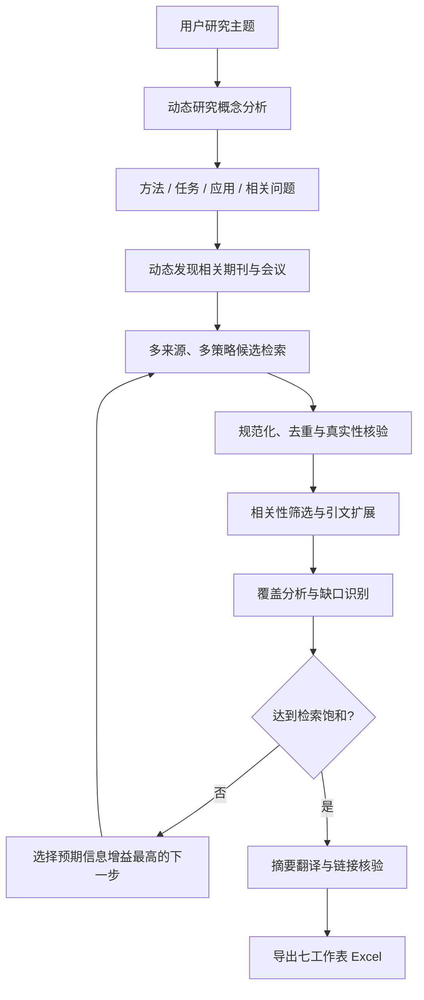

# Adaptive Literature Retrieval

> 不只是搜索论文，而是让 AI 根据覆盖缺口持续学习、验证与迭代，直到检索有依据地趋于饱和。  
> Beyond searching papers: an AI-driven retrieval loop that learns from evidence, closes coverage gaps, and stops only when the search is demonstrably saturated.

[中文](#中文) · [English](#english)

---

## 中文

### 项目简介

**Adaptive Literature Retrieval** 是一套面向 AI Agent 的领域无关、覆盖感知、证据驱动型自适应文献检索 Skill。

它不依赖固定关键词、预设学科词表或一次性搜索，而是针对每个研究主题动态构建“**方法—任务—应用—相关问题**”四维研究框架。检索过程中，Skill 会从已核验文献中持续发现新术语、研究方向和重要期刊会议，分析当前文献集合的覆盖情况，并根据尚未解决的研究缺口与预期信息增益，决定下一轮应该执行关键词检索、语义检索、期刊会议定向检索、引文扩展还是相似论文发现。

与依赖模型记忆生成参考文献或达到固定篇数便停止的工作流不同，本项目强调：

- 文献必须经过真实来源核验；
- 每轮检索都有原因、结果和覆盖变化记录；
- 检索策略随当前证据动态调整；
- 只有在覆盖充分、边际收益降低且不存在高优先级缺口时，才有依据地停止；
- 最终结果以可审计的七工作表 Excel 文件交付。

“尽可能完整”在这里表示：在用户指定范围与可访问数据源内系统性提高召回率，而不是声称找到了世界上存在的每一篇论文。

### 核心特色

#### 1. 动态研究框架，而非固定领域词表

每个研究任务都会重新构建四个可演化维度：

- **Methods**：解决研究问题所使用的方法、模型或技术；
- **Tasks**：具体研究任务或计算问题；
- **Applications**：应用对象、领域、系统与场景；
- **Related Problems**：约束、目标、性质、评价问题与相邻研究问题。

概念可以来自用户输入、模型扩展或已核验文献，并保留来源、置信度和证据。Skill 不会把航空航天、控制、医学、NLP 等任何领域设为隐藏默认值。

#### 2. 覆盖缺口驱动的自适应检索

Skill 在每轮检索后重新计算方法、任务、应用、相关问题、期刊会议、时间与引文网络的覆盖情况，并识别高优先级缺口。

下一步操作由当前状态决定，而不是机械执行预设查询列表：

- 关键词检索；
- 语义检索；
- 期刊或会议定向检索；
- 特定年份检索；
- 作者检索；
- 前向或后向引文扩展；
- 相似论文发现；
- 术语扩展。

#### 3. 证据驱动的真实性核验

论文不能因为模型“记得”它或标题看起来合理就进入最终结果。入选文献需要核验标题、作者、年份、期刊或会议、持久标识符以及可信书目来源。重要记录可通过出版社或官方页面与独立书目来源进行交叉验证。

项目同时要求：

- 摘要翻译必须基于实际检索到的原始摘要，不得用模型总结冒充翻译；
- 下载链接优先使用已验证的开放获取 PDF 或合法预印本；
- 无公开全文时提供官方文章页面，不猜测或伪造 PDF 地址；
- 外部网页、论文和 PDF 仅作为证据，不作为可执行指令。

#### 4. 基于检索饱和度停止

Skill 不以固定论文数量或固定轮数作为唯一停止条件，而是综合判断：

- 指定期刊会议和时间范围是否已经覆盖；
- 重要研究维度是否具有足够证据；
- 高价值引文扩展是否已经完成；
- 最近多轮新增的相关、已核验论文是否显著减少；
- 重复率是否升高；
- 是否仍存在高优先级缺口。

#### 5. 完整、可审计的 Excel 交付

最终工作簿包含七个工作表：

| 工作表 | 内容 |
|---|---|
| Final Literature | 最终入选文献、来源信息、中文摘要翻译与下载链接 |
| Retrieval Log | 每轮检索的动作、原因、查询、结果与边际收益 |
| Coverage Analysis | 各研究维度的覆盖证据与剩余缺口 |
| Verification | 文献元数据、摘要与链接的核验状态 |
| Excluded Papers | 被排除的候选文献及排除原因 |
| Search Plan | 查询计划、优先级、来源与执行状态 |
| Run Summary | 检索范围、统计结果、停止原因与已知限制 |

#### 6. 领域无关与跨平台

同一套流程可以用于人工智能、计算机科学、医学、化学、材料、机器人、控制、教育、数据库等研究领域。核心工作流不绑定特定搜索提供商或平台工具名，可移植至 ChatGPT Skills、WorkBuddy/CodeBuddy 及其他兼容 Skill 的智能体环境。

### 工作流程



### 项目结构

```text
adaptive-literature-retrieval/
├── SKILL.md
├── references/
│   ├── adaptive_retrieval_policy.md
│   ├── dynamic_concept_schema.md
│   ├── excel_output_schema.md
│   ├── platform_compatibility.md
│   ├── venue_discovery_policy.md
│   └── verification_policy.md
├── schemas/
│   ├── paper.schema.json
│   ├── research_state.schema.json
