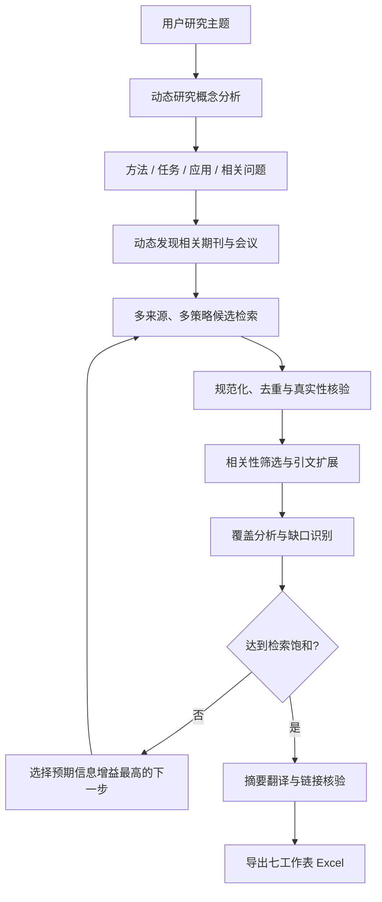
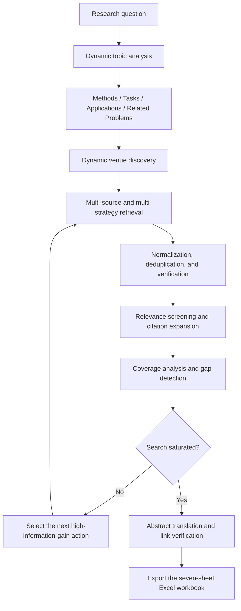

> 不只是搜索论文，而是让 AI 根据覆盖缺口持续学习、验证与迭代，直到检索有依据地趋于饱和。  
> Beyond searching papers: an AI-driven retrieval loop that learns from evidence, closes coverage gaps, and stops only when the search is demonstrably saturated.

[中文](#中文) · [English](#english)
[中文](README.md) · [English](README_EN.md)

---


同一套流程可以用于人工智能、计算机科学、医学、化学、材料、机器人、控制、教育、数据库等研究领域。核心工作流不绑定特定搜索提供商或平台工具名，可移植至 ChatGPT Skills、WorkBuddy/CodeBuddy 及其他兼容 Skill 的智能体环境。

### 工作流程



### 项目结构

```text

Skill 将依次完成主题拆解、动态期刊会议发现、多策略检索、去重、真实性核验、相关性筛选、引文扩展、覆盖分析、缺口驱动迭代、饱和度判断以及结构化导出。

### 科研引用

如果本项目对你的研究有帮助，请在论文、报告或软件成果中引用：

> Adaptive Literature Retrieval Contributors. (2026). *Adaptive Literature Retrieval: A coverage-aware and evidence-grounded literature retrieval skill for AI agents* [Computer software].

```bibtex
@software{adaptive_literature_retrieval_2026,
  author = {{Adaptive Literature Retrieval Contributors}},
  title  = {Adaptive Literature Retrieval: A Coverage-Aware and Evidence-Grounded Literature Retrieval Skill for AI Agents},
  year   = {2026},
  note   = {Domain-agnostic adaptive literature retrieval with gap-driven search, evidence verification, and auditable outputs}
}
```

仓库正式发布后，可在上述条目中补充版本号、GitHub URL 或归档 DOI。若发布版本提供 DOI，请优先引用对应版本的 DOI。

### 设计边界

- 本项目不能保证发现世界上存在的每一篇相关论文；数据库覆盖、访问权限和索引延迟都会影响结果。

The same workflow can be applied to AI, computer science, medicine, chemistry, materials science, robotics, control, education, databases, and other fields. The core logic does not depend on a specific search provider or platform tool name, allowing it to run in ChatGPT Skills, WorkBuddy/CodeBuddy, and other compatible agent environments.

### Workflow



### Installation

1. Download the Skill ZIP from GitHub Releases or clone this repository.
retrieved abstracts into Chinese, verify all links, and export the results to Excel.
```

### Citation

If this project supports your research, please cite it in papers, reports, or software outputs:

> Adaptive Literature Retrieval Contributors. (2026). *Adaptive Literature Retrieval: A coverage-aware and evidence-grounded literature retrieval skill for AI agents* [Computer software].

```bibtex
@software{adaptive_literature_retrieval_2026,
  author = {{Adaptive Literature Retrieval Contributors}},
  title  = {Adaptive Literature Retrieval: A Coverage-Aware and Evidence-Grounded Literature Retrieval Skill for AI Agents},
  year   = {2026},
  note   = {Domain-agnostic adaptive literature retrieval with gap-driven search, evidence verification, and auditable outputs}
}
```
